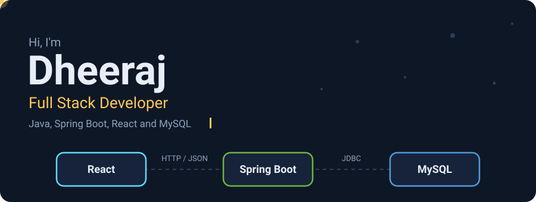

## Hi there 👋

<!--
**Dheeraj4837/Dheeraj4837** is a ✨ _special_ ✨ repository because its `README.md` (this file) appears on your GitHub profile.

Here are some ideas to get you started:

- 🔭 I’m currently working on ...
- 🌱 I’m currently learning ...
- 👯 I’m looking to collaborate on ...
- 🤔 I’m looking for help with ...
- 💬 Ask me about ...
- 📫 How to reach me: ...
- 😄 Pronouns: ...
- ⚡ Fun fact: ...
-->
<!--
   
    
    

  

-->
  

  

### About me

I build full stack web applications with Java, Spring Boot, React and MySQL.
Right now I am learning new technologies and improving my English communication.

### Things I've built

| Project | What it does | Stack |
| ------- | ------------ | ----- |
| [Project name](https://github.com/USERNAME/REPO) | One line about it | React, Spring Boot |

### Connect

[LinkedIn](https://www.linkedin.com/in/YOUR-ID) · [Email](mailto:you@example.com)

